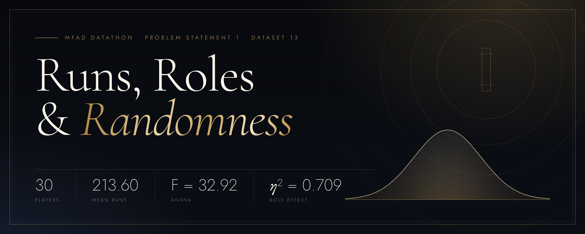
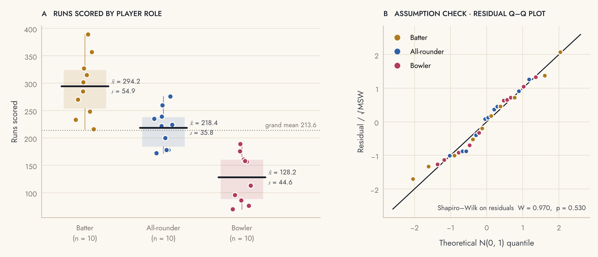
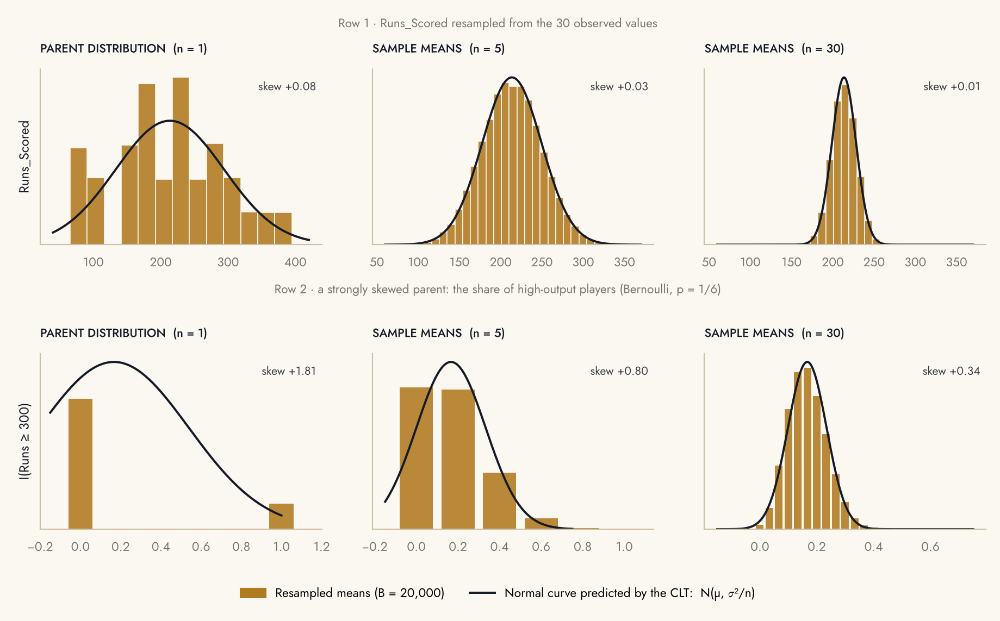
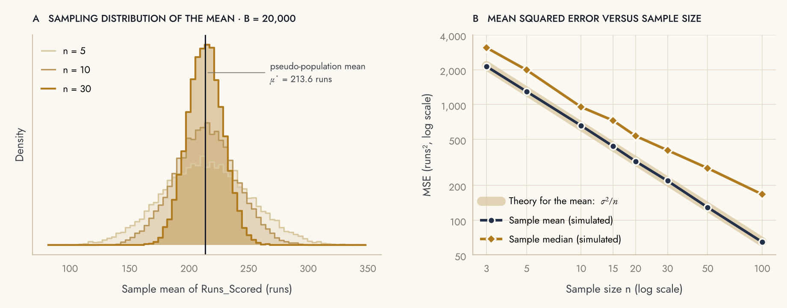
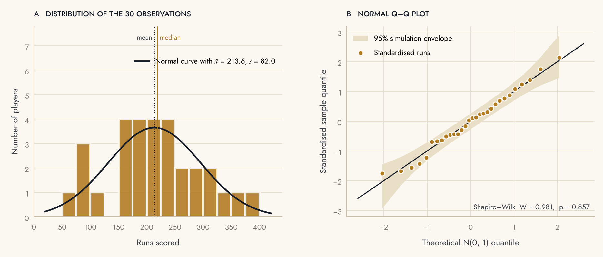
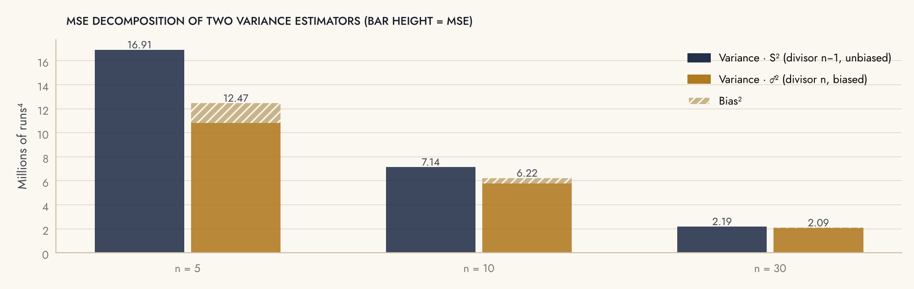

<div align="center">



<br>

<a href="https://ashen-iron.github.io/maths-datathon/"></a>
<a href="report/MFAD_Datathon_Report.pdf"></a>
<a href="analysis.py"></a>


<br><br>

<em>A statistical inquiry into thirty cricketers: how runs are sampled, estimated and distributed,<br>and whether a player’s role changes what we should expect.</em>

<br><br>

**[Explore the website](https://ashen-iron.github.io/maths-datathon/)** &nbsp;·&nbsp; **[Read the report](report/MFAD_Datathon_Report.pdf)** &nbsp;·&nbsp; **[Run the code](#-reproduce-in-two-commands)**

<br>


</div>

## ✦ The question

> **How many runs does a typical player in this sample score, how precisely can that be estimated, is a normal model reasonable for run output, and does mean run output differ between batters, all-rounders and bowlers?**

One outcome (**`Runs_Scored`**) and one factor (**`Player_Role`**) carry a single question through all five tasks of Units 3 and 4. `Player_ID` is an identifier and is excluded from every calculation.

## ✦ Headline findings

<table>
<tr>
<td width="20%" align="center"><sub>TASK 1 · SAMPLING</sub><br><h3>0.027</h3><sub>P(exact 10/10/10 split)<br>under random sampling</sub></td>
<td width="20%" align="center"><sub>TASK 2 · ESTIMATION</sub><br><h3>213.60</h3><sub>mean runs<br>95% CI 183.0 – 244.2</sub></td>
<td width="20%" align="center"><sub>TASK 3 · NORMALITY</sub><br><h3>p = 0.857</h3><sub>Shapiro–Wilk<br>W = 0.9812</sub></td>
<td width="20%" align="center"><sub>TASK 4 · ANOVA</sub><br><h3>F = 32.92</h3><sub>df (2, 27), p = 5.75×10⁻⁸<br>η² = 0.709</sub></td>
<td width="20%" align="center"><sub>TASK 5 · χ² FIT</sub><br><h3>χ² = 1.000</h3><sub>df = 2, p = 0.607<br>normal model fits</sub></td>
</tr>
</table>

| | Task | Method | Result | Meaning in context |
|:-:|:--|:--|:--|:--|
| **I** | Sampling design | Design review, multinomial check | Undocumented; exact 10/10/10 role split | Quota-like, non-probability sample. Generalise with caution. |
| **II** | Point estimation & MSE | x̄, s², resampling (B = 20,000) | x̄ = 213.60, s² = 6,716.39, SE = 14.96 | MSE = variance + bias². Unbiased does not mean minimum MSE. |
| **III** | Normal model & CLT | Shape, Q–Q, Shapiro–Wilk, resampling | W = 0.9812, p = 0.857 | Normal model plausible. Means become normal even from a skewed parent. |
| **IV** | One-way ANOVA | F test, Levene, η², ω² | F(2, 27) = 32.92, p = 5.75×10⁻⁸ | Mean runs differ by role (very large effect). Observational, so not causal. |
| **V** | χ² goodness-of-fit | Pearson χ², 5 equal-probability classes | χ² = 1.000, df = 2, p = 0.607 | Counts are consistent with the normal model. |

> [!NOTE]
> Every number above is produced by `analysis.py` and stored in `results/results.json`. The PDF report and the website read those numbers at build time, so neither can disagree with the code.

<div align="center"></div>

## ✦ Gallery

<table>
<tr>
<td width="50%"><br><sub><b>FIG 6</b> · Runs by role, with a residual Q–Q check</sub></td>
<td width="50%"><br><sub><b>FIG 5</b> · The Central Limit Theorem with a symmetric and a skewed parent</sub></td>
</tr>
<tr>
<td width="50%"><br><sub><b>FIG 2</b> · The sampling distribution narrows and MSE falls like 1/n</sub></td>
<td width="50%"><br><sub><b>FIG 4</b> · Histogram with normal fit, and Q–Q plot with 95% envelope</sub></td>
</tr>
<tr>
<td width="50%"><br><sub><b>FIG 3</b> · MSE decomposition: the biased σ̂² beats the unbiased s²</sub></td>
<td width="50%"><br><sub><b>FIG 8</b> · Observed against expected counts in five normal classes</sub></td>
</tr>
</table>

<div align="center"></div>

## ✦ Submission files

| File | What it is |
|:--|:--|
| 📄 **[`report/MFAD_Datathon_Report.pdf`](report/MFAD_Datathon_Report.pdf)** | The report: answers, results, test cards, figures, observations, conclusions and all ten reflection answers |
| 🐍 **[`analysis.py`](analysis.py)** | One Python file that runs top to bottom and reproduces every number, table and plot in the report |

## ✦ Reproduce in two commands

```bash
pip install -r requirements.txt
```

```bash
python analysis.py
```

This writes `figures/` (PNG + SVG), `results/tables/*.csv` and `results/results.json`, and prints a full console report. All resampling uses a fixed seed (`20261118`, B = 20,000), so every run gives identical numbers.

<details>
<summary><b>Optional: rebuild the PDF report and the website</b></summary>
<br>

The presentation layer is built with Node.js and Playwright (headless Chromium). It does no statistics; it only places the numbers from `results/results.json` into the templates.

```bash
npm install
```

```bash
npx playwright install chromium
```

```bash
node tools/build.cjs
```

To put your team name and members on the PDF cover, fill in `report/meta.json` and rebuild.
</details>

## ✦ Repository structure

```text
maths-datathon/
├── analysis.py                  ← the submission code: all statistics, tables and figures
├── data/Dataset_13.csv          ← the assigned dataset, unmodified
├── report/
│   ├── MFAD_Datathon_Report.pdf ← the submission report
│   ├── template.html            ← report layout (placeholders filled from results.json)
│   ├── report.html              ← generated HTML source of the PDF
│   └── meta.json                ← team name / members for the cover
├── figures/                     ← fig01–fig08 as PNG and SVG (generated)
├── results/
│   ├── results.json             ← every reported number (generated)
│   └── tables/*.csv             ← every reported table (generated)
├── docs/                        ← the website (GitHub Pages)
│   ├── index.html
│   ├── assets/{css,js,fonts,img,vendor}
│   └── downloads/               ← PDF, analysis.py and CSV offered on the site
├── tools/
│   ├── build.cjs                ← builds the PDF, the website and the README banner
│   ├── site.template.html       ← website template
│   └── banner.html              ← README banner and social card
├── assets/fonts/                ← bundled typefaces (SIL Open Font License)
├── requirements.txt · package.json · .gitignore
└── README.md
```

## ✦ Method notes

- **Population and sample.** The unit is one player and n = 30. The sampling process is undocumented, so the sample is treated as non-probability (quota-like) and is not assumed random or representative.
- **Estimation.** The 30 values serve as a known pseudo-population. Bias, variance and MSE of the mean, median, s² and σ̂² are measured by resampling and checked against exact theory.
- **CLT.** Runs_Scored and a deliberately skewed indicator, I(Runs ≥ 300), are resampled at n = 1 to 50. Skewness decays like γ/√n.
- **ANOVA.** Assumptions are checked with per-group Shapiro–Wilk tests, a residual Q–Q plot, a Brown–Forsythe Levene test and the SD ratio. Effect sizes η², ω² and Cohen’s f are reported. No post-hoc tests were run, as the task requires.
- **χ².** The expected distribution was fixed *before* counting: five classes equally probable under the fitted normal model, 6 expected per class, df = K − 1 − 2. A Chernoff–Lehmann bound is reported.
- **Throughout.** Every test reports H₀/H₁, α, the statistic, df, the p-value and a conclusion in context. Statistical significance is kept separate from practical importance, and no result is read causally.

## ✦ The website

The [`docs/`](docs) folder holds a self-contained website with an animated Central Limit Theorem hero, interactive D3 charts, an estimator lab and a CLT lab. It runs offline and needs no build step to view.

**Publish it:** go to repository **Settings → Pages → Build and deployment**, set **Source** to *Deploy from a branch*, choose the branch, select the **`/docs`** folder and save. It will appear at `https://ashen-iron.github.io/maths-datathon/`.

## ✦ Credits

Typefaces: [Cormorant Garamond](https://fonts.google.com/specimen/Cormorant+Garamond), [EB Garamond](https://fonts.google.com/specimen/EB+Garamond), [Jost](https://fonts.google.com/specimen/Jost) and [DM Mono](https://fonts.google.com/specimen/DM+Mono), all under the SIL Open Font License. Charts on the website use [D3.js](https://d3js.org) v7.9.0 (ISC License). Analysis uses NumPy, pandas, SciPy and Matplotlib.

<div align="center">
<br>

<br>
<sub>PES UNIVERSITY &nbsp;·&nbsp; MFAD DATATHON 2026 &nbsp;·&nbsp; PROBLEM STATEMENT 1 &nbsp;·&nbsp; DATASET 13</sub>
</div>
